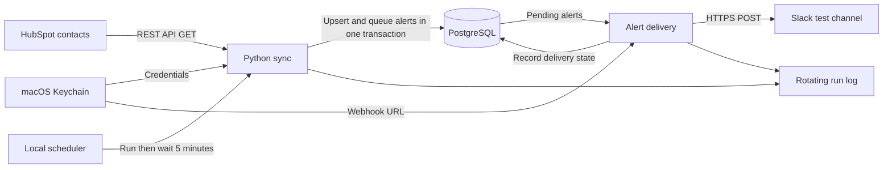

# Acme CRM Integration

A Solutions Engineer portfolio project for fictional customer Acme SaaS. A local Python service copies HubSpot contacts into PostgreSQL and sends a Slack alert when it first observes a contact as a Sales Qualified Lead.

## Customer problem

Acme SaaS is a fictional 25-person project-management software company. Sales maintains contacts in HubSpot, while operations needs current records for reporting. Manual exports become outdated and require repeated cleanup. Sales also wants a notification when a contact qualifies for follow-up.

The integration demonstrates customer requirements, REST API access, data mapping, repeatable database writes, operational logging, and a downstream workflow. No measured business savings are claimed.

## Architecture



Each run fetches all pages before changing the database. HubSpot IDs identify existing rows. Contact changes and new alert records commit together. Slack delivery happens after that transaction, so a Slack failure does not undo the contact sync.

## Implemented behavior

- Fetch first name, last name, email, lifecycle stage, and source creation/update timestamps.
- Insert new contacts and update existing contacts by HubSpot ID.
- Queue one lifetime alert per contact first observed with `lifecyclestage=salesqualifiedlead`, including contacts already at that stage on the first run.
- Claim an alert durably before sending, then mark it sent only after Slack confirms delivery.
- Retry temporary HubSpot errors up to three times after the initial request, with increasing waits and bounded handling of Retry-After.
- Log UTC timestamps, run IDs, outcomes, counts, and duration without logging credentials or contact fields.
- Run locally, waiting five minutes after each successful run. Stop on failure for investigation.

## Requirements

The demonstrated setup uses macOS, Python 3.13, a running local PostgreSQL server, a HubSpot practice account with contact-read access, and a Slack incoming webhook for a test channel. Keychain storage and the scheduler are macOS-oriented. AWS is outside this project's scope.

## Setup

Open Terminal in this project folder, then run:

```bash
python3 -m venv .venv
source .venv/bin/activate
python -m pip install -r requirements.txt
createdb acme_crm
```

Create the database only once. The scripts assume your macOS user can connect locally; `DATABASE_URL` can override the default `dbname=acme_crm` connection. Database credentials are not managed by the Keychain helpers.

In HubSpot, create a Service Key with contact-read permission under Settings → Integrations → Service Keys, or Development → Keys → Service Keys. Save it locally:

```bash
python local_credentials.py
```

In Slack, create an app, enable Incoming Webhooks, and add a webhook to your test channel. This setup command saves that webhook separately in Keychain and sends one test message:

```bash
python setup_slack.py
```

Enter secrets only at the hidden prompts. Do not add them to source files or a repository. macOS may request Keychain access.

## Running the integration

```bash
python sync_contacts.py
```

Manual runs prompt for the HubSpot key unless `HUBSPOT_ACCESS_TOKEN` is set. Slack delivery uses the saved webhook. The first run creates the tables and adds the lifecycle-stage column if upgrading the earlier demo.

For automatic runs using the saved HubSpot key:

```bash
python auto_sync.py
```

Keep Terminal open, the Mac awake, and PostgreSQL running. Control+C stops the scheduler. A lock prevents two scheduler processes for the same folder; avoid running manual syncs alongside it.

## Inspecting results

```bash
psql -d acme_crm -c "SELECT hubspot_id, first_name, last_name, lifecycle_stage FROM contacts ORDER BY hubspot_id;"
psql -d acme_crm -c "SELECT hubspot_id, status, sent_at FROM lead_alerts ORDER BY created_at;"
tail -n 15 logs/sync.log
```

An alert's status is `pending`, `attempted`, or `sent`. An `attempted` record means delivery is unconfirmed, including a possible interruption between claiming and sending. Stop the scheduler and check the Slack channel before deciding whether to record a confirmed delivery or manually requeue that specific alert. Do not clear the alert table to fix a failed run: doing so removes duplicate protection.

## Verification evidence

During the guided local demonstration, the user confirmed:

| Check | Observed result |
| --- | --- |
| Read HubSpot contacts | Contacts appeared in Python |
| Repeat database sync | Total row count stayed unchanged |
| Edit Maya's first name | Updated name appeared in PostgreSQL |
| Logging | Successful run status appeared in the log |
| Local scheduling | A second run completed without another key prompt |
| Slack connection | Test message arrived |
| Lead notification | Maya's alert arrived once across two runs |

Run the nine automated, offline tests with:

```bash
python -m unittest -v test_reliability.py test_lead_alerts.py
```

These tests simulate HubSpot and database/Slack interactions. They cover retry limits, invalid credentials, pagination during retries, and alert success/uncertainty paths. They do not replace live database, concurrency, or end-to-end tests. Nine tests passed during development.

## Design limits

- This is a local prototype, not a continuously hosted service. The scheduler stops when the process stops and does not restart automatically after failure or reboot.
- Every run loads all fetched contacts into memory. Incremental sync and large-volume tuning are future work.
- Deleted or archived HubSpot contacts are not removed from PostgreSQL.
- Only the exact Sales Qualified Lead stage qualifies. Custom stages and contacts that pass through that stage between polls may be missed.
- Alerts are once per contact, not once per stage transition. Pending alerts describe a qualification previously observed even if the contact later changes stage.
- Delivery is not guaranteed exactly once. Claiming before sending prevents automatic repeat attempts but can leave a missed or uncertain alert requiring review.
- Slack sends are not automatically retried or paced for bulk delivery. The workflow was demonstrated with a small set of fictional records.
- The demonstration uses one HubSpot account and one Slack channel. OAuth, multi-customer isolation, dashboards, company associations, and cloud deployment are not implemented.

## Project files

| File | Purpose |
| --- | --- |
| `read_contacts.py` | HubSpot pagination and bounded retries |
| `sync_contacts.py` | Contact transformation, upserts, and alert queueing |
| `schema.sql` | Contacts and alert tracking tables |
| `lead_alerts.py` | Claim, send, and record lead alerts |
| `slack_client.py` | Webhook validation and one HTTP send attempt |
| `local_credentials.py` | Save HubSpot key to macOS Keychain |
| `setup_slack.py` | Save webhook and send a test message |
| `auto_sync.py` | Sequential local schedule with process lock |
| `sync_logging.py` | Rotating log configuration |
| `test_reliability.py` and `test_lead_alerts.py` | Offline behavior checks |
| `DEMO.md` | Interview walkthrough and talking points |

## References

- [HubSpot Service Keys](https://developers.hubspot.com/blog/hubspot-service-keys-the-right-api-credential-for-data-integrations)
- [HubSpot lifecycle stages](https://knowledge.hubspot.com/records/use-lifecycle-stages)
- [Slack incoming webhooks](https://docs.slack.dev/messaging/sending-messages-using-incoming-webhooks/)
- [Python keyring](https://keyring.readthedocs.io/en/latest/index.html)


